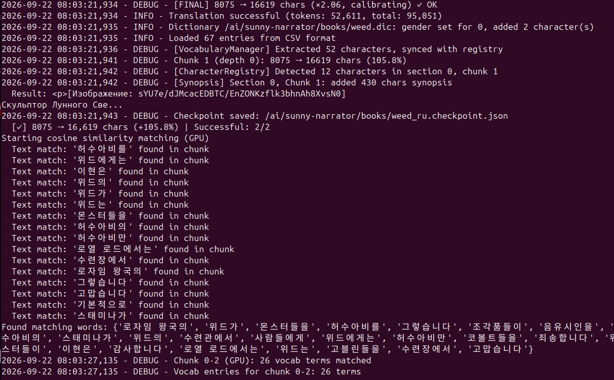

# Logging — Console Log and LLM Call Log

Sunny Narrator writes two independent logs:

| Log | Where | Enabled by |
|-----|-------|------------|
| **Console log** | stdout/stderr | always (`INFO`); `DEBUG=on` for details |
| **LLM call log** | `logs/llm_calls_YYYY-MM-DD.log` | `LLM_LOGGING=true` |

## ⚙️ Configuration (.env)

```bash
# Console log level: off → INFO, on → DEBUG
DEBUG=off

# With DEBUG=on, wire-level traces of httpx/httpcore/openai and duplicate
# pypandoc lines are suppressed; set on to see them too
DEBUG_HTTP=off

# Every LLM call as a JSON line
LLM_LOGGING=false
LLM_LOGGING_DIR=logs
```

## 🖥️ Console Log

Format: `timestamp - LEVEL - message`.



What the screenshot shows (Korean → Russian, `DEBUG=on`, an older version):

| Line | Meaning |
|------|---------|
| `[FINAL] 8075 → 16619 chars (×2.06, calibrating) ✓ OK` | Length check of the final translation. `calibrating` — fewer than 3 chunks accepted so far, only gross failures are rejected; afterwards it reads `expected ×N.NN` (the book's median ratio) |
| `Dictionary …/weed.dic: gender set for 0, added 2 character(s)` | With `DICT_AUTO_SAVE=true`: genders and characters reported by the synopsis written into the `.dic`. By default they only join the in-memory dictionary (`[gender] Janet = she: from the synopsis (2 chunks agree)`, `Dictionary: added …`) |
| `Loaded 67 entries from CSV format` / `Extracted 52 characters, synced with registry` | The dictionary is reloaded so the next chunk already sees the new genders |
| `Chunk 1 (depth 0): 8075 → 16619 chars (105.8%)` | Chunk summary: source → translation length. `depth` > 0 means the chunk was split (rechunking) |
| `[CharacterRegistry] Detected 12 characters …` / `[Synopsis] … added 430 chars synopsis` | Characters found in the chunk and the synopsis carried to the next chunk |
| `Checkpoint saved: …/weed_ru.checkpoint.json` | Progress saved — a restart resumes from here ([RESUME.md](RESUME.md)) |
| `Lexical matches: [...]` | Dictionary terms found in the next chunk by word forms (surface, stem, lemma; substring for CJK); the rest are searched by cosine similarity ([NER_GUIDE.md](NER_GUIDE.md)) |
| `Chunk 0-2 (GPU): 26 vocab terms matched` | Number of dictionary entries passed to the translation prompt |

### Messages worth attention

| Message | Level | What to do |
|---------|-------|------------|
| `⚠ SPLIT [FINAL] … rechunking needed` | ERROR | The translation length deviates from the expected ratio by more than `LENGTH_CHECK_THRESHOLD` — the chunk is split and retranslated ([RECHUNKING_GUIDE.md](RECHUNKING_GUIDE.md)) |
| `RECHUNK FAIL-FAST …` | ERROR | Half of a split chunk came back empty — the chunk is not assembled from partial results |
| `LLM call cap (…) reached` | WARNING | The per-chunk LLM call limit was hit; check the model and the chunk |
| `Empty synopsis returned` | WARNING | The next chunk is translated without synopsis context |
| `Words in two alphabets: dверей, …` | WARNING | Words the model wrote half in Latin reached the book; they are listed in the report at the end — fix them by search. `[improve_translation] words in two alphabets` (INFO) is an intermediate stage, the next stage often fixes them |
| `Dictionary check skipped: spaCy model … is not available` | WARNING | Offline or `SPACY_AUTO_DOWNLOAD=false`: download the model (`python -m spacy download …`) |
| `✗ Stopped: the … LLM refused the request (…)` | exit code 3 | The API refused the key (401), the access (403) or the model (404); the message names the variable to check |

### The report at the end of a run

`TRANSLATION METRICS REPORT`: successful and failed chunks, total tokens, how
many chunks were split, words in two alphabets, gender errors found and fixed
by the GENDER stage, the characters the translation keeps disagreeing with the
dictionary on (check their gender in the `.dic`), the genders the synopsis
filled in, the elapsed time and the output file.

## 📄 LLM Call Log

With `LLM_LOGGING=true` every LLM call is appended as one JSON line to `LLM_LOGGING_DIR/llm_calls_YYYY-MM-DD.log`:

| Field | Content |
|-------|---------|
| `timestamp` | ISO time of the call |
| `stage` / `role` | Pipeline stage (`initial`, `reflection`, `improve`, `final`, `synopsis`) and LLM role (`translate`/`proofread`) |
| `model`, `temperature` | Model and temperature used |
| `duration_ms` | Call duration |
| `tokens_input`, `tokens_output`, `tokens_total` | Token usage |
| `prompt_system`, `prompt_user`, `response` | Full prompts and raw response |

Useful for debugging prompts, auditing quality and measuring cost. The file grows quickly — full prompts are stored for every stage of every chunk.

```bash
# Tokens per stage for today
jq -r '[.stage, .tokens_total] | @tsv' logs/llm_calls_$(date +%F).log
```
